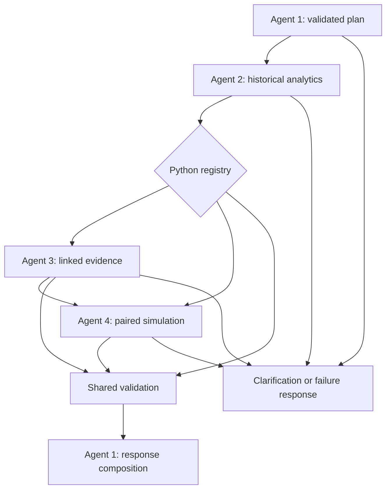

# Stage 6 — Four agents and controlled LangGraph orchestration

## Scope and acceptance

Stage 6 connects the existing services. It adds no business HTTP endpoint, UI,
simulation engine, analytics formula, retrieval engine, dependency or migration.
Alembic remains at `0002`. The original plan and Day 1 hours 5.5–7 are unchanged.
Implementation, live combined execution, preservation and final output checks
are verified. **Stage 6 is complete.** Executed results are recorded in
`docs/implementation-status.md`. Live natural-language acceptance is separate
from mocked tests.

The request mentioned `core/contracts.py`; that file does not exist. The actual
shared contracts are `domain/models.py` and `domain/enums.py`. Stage 6 reuses
those locations rather than inventing a second shared-contract module.

## Four agents

The approved chat refinement adds optional `previous_investigation_id` to
`InvestigationRequest`. Existing standalone requests retain their behavior.
`workflows/context.py` reads at most five finalized, linked audits in a read-only
transaction before creating the new initial audit. Matching response/audit IDs,
dataset ID/content hash, period and cycle checks prevent unconfirmed or unrelated
records from becoming context. A period change omits prior context; another
dataset/version or invalid parent is rejected before admission.

The planner receives chronological, bounded question/answer summaries, scope,
outcome, candidate, historical JPH, scenario and qualified evidence labels.
Failed/unsupported/clarification turns retain the question and clarification but
no answer findings. Explicit new questions and selected scope take precedence.
Ambiguous references still clarify. Every follow-up runs the registered tools
again; hypotheses are not trusted facts. New request/context fields persist in
the existing JSONB audit, without a migration, queue or fifth agent.

| Module under `src/bottleneck_analyzer/agents/` | Responsibility and boundary |
| --- | --- |
| `planner.py` | Agent 1 interprets language, validates the plan against a Python registry, handles clarification and composes a grounded answer. It never calls specialist services itself. |
| `analytics.py` | Agent 2 calls `analytics.service.analyze(engine, AnalyticsScope)` and preserves the result's dataset, period and filters. |
| `knowledge.py` | Agent 3 calls `request_from_analytics()` and `retrieve()`, retains source provenance/conflicts and uses the LLM to select supporting passages without upgrading assessment labels. |
| `simulation.py` | Agent 4 validates a scenario and invokes Stage 3 `compare()` and `assess_comparison()` in a bounded worker process. |

`agents/contracts.py` contains only missing orchestration types. Existing
`AnalyticsScope`, `AnalyticsResult`, `RetrievalResult`, `ScenarioRequest`,
`QuestionIntent`, `InvestigationStatus` and `SimulationConfig` remain authoritative.
`WorkflowState` refines the foundational `InvestigationState` with typed tool
results. Validation, response projection and audit persistence are application
functions, not extra agents.

## Registry and graph

| Intent | Required specialist sequence |
| --- | --- |
| `constraint_output_loss` | analytics |
| `segmentation` | analytics |
| `causes` | analytics → knowledge |
| `what_if` | analytics → simulation |
| `combined` | analytics → knowledge → simulation |



The implementation uses installed LangGraph `1.2.20`, `StateGraph(WorkflowState)`,
explicit conditional edge maps and compilation. Every routing decision checks the
registry. There is no model-selected function name, SQL tool, dynamic module,
tool-calling loop or nested agent framework. The maximum graph step count defaults
to 10. The graph is acyclic; errors route directly to an incomplete response.
See the [official Graph API documentation](https://docs.langchain.com/oss/python/langgraph/graph-api)
for the state/node/conditional-edge API.

Analytics precedes evidence because candidate context is needed. Simulation also
uses the validated dataset configuration and optional historical candidate target.
These dependencies are intentionally sequential. Independent investigations can
use separate workflow instances; do not share one mutable instance concurrently.
Follow-ups can reuse a caller-supplied validated scope. No generated hypothesis
is automatically promoted into trusted memory.

## Input and scope boundaries

An investigation contains a 3–2,000-character question, an explicit dataset,
optional dataset UUID, analysis filters, optional incident/work-order UUIDs,
retrieval limit and optional scenario execution settings. Missing dates resolve
explicitly to the selected dataset period. Question-derived filters may narrow
that period; they cannot conflict with explicit caller filters. Foreign dataset
and shift UUIDs fail validation. Incident IDs are checked by the existing Stage 5
service and are meaningful only on an evidence route.

Shift/hour filters can narrow Stage 4's returned outer time bounds. The analytics
adapter permits that narrowing, preserving the exact request scope and rejecting
results outside it. Closed-period JPH remains null. The model-attribution limits,
candidate abstention, support/conflicts and segment warnings remain intact.

"Reduce robot-fault downtime by 30%" without a method produces clarification
before specialist execution. The two supported methods are `repair_duration` and
`failure_rate`. Station/category/equipment and parameter ranges are validated
against the existing configuration. Unsupported equipment/control/work-order
requests do not execute production actions.

Simulation uses the selected dataset's stored configuration, not an independently
reconstructed baseline. If that configuration is absent or ambiguous, the workflow
requests clarification. Segmented history is not silently simulated as an
equivalent full-line baseline: model, shift, dated-shift or UTC-hour filters on a
simulation request require a separate unsegmented scenario. Partial historical
periods likewise need a request using the stored baseline's full period.
An explicitly shortened scenario horizon is separately reported, with its own
paired baseline and uncertainty; it does not replace the retained historical run.

## LLM configuration and grounded interpretation

`core/llm.py` uses standard-library HTTPS, matching the existing embedding adapter's
convention. No SDK dependency was added. Configure local environment values:

```dotenv
LLM_PROVIDER=openai
LLM_MODEL=<your approved model supporting Responses structured outputs>
LLM_API_KEY=<local secret>
LLM_BASE_URL=https://api.openai.com/v1
LLM_TIMEOUT_SECONDS=30
LLM_MAX_OUTPUT_TOKENS=4000
```

The supported adapter is OpenAI; missing or unsupported provider/model/key fails
clearly. It calls `/responses` with `store=false`, a strict JSON schema and no
tools. Nullable fields are explicitly required in the provider schema. Results
are independently validated with Pydantic and Python policy checks. Refusals,
incomplete responses, malformed outputs and transport failures cannot become a
successful plan. There are zero automatic retries and no fake language fallback.
The adapter follows the [official structured-output documentation](https://developers.openai.com/api/docs/guides/structured-outputs).

Agent 3 uses the question and bounded passages to select relevant supporting
source IDs. Its per-request strict schema enumerates only eligible IDs. Python
copies the corresponding verbatim excerpts (up to 500 characters), assessment
statement, label and conflicting IDs; the model cannot generate those facts.
Instruction-like records cannot supply supporting excerpts. Unresolved questions
are derived from the assessment's known causal/linking limitations. This is
deliberately extractive interpretation, not autonomous causal discovery. Original
source text/metadata remains available separately.

Agent 1 now composes the complete answer using the exact question, bounded
conversation context and a catalogue of current validated findings. Its structured
draft identifies the answer goal and supporting fact IDs before writing prose.
Python checks quantity references or exact computed values with units, source
references, simulation uncertainty and common causal/constraint overclaims.
One malformed draft may receive one bounded correction attempt using the same
facts; repeated invalid output fails composition rather than falling back to a
category answer. Language-model wording remains subject to human review: these
checks establish numerical/reference consistency, not proof of every paraphrase.
The explanation stores fact IDs and question_specific_v1 metadata in existing
audit JSONB. The final renderer and API preserve its wording instead of appending
or substituting a category template. Older audits retain their original behavior
on read; they are not silently regenerated through paid calls.

## Simulation bounds and uncertainty

Defaults are 20 paired replications, separate five-seed/three-day baseline and
scenario sensitivity checks, at most 30 scenario days and a 600-second runtime
limit. Environment settings can explicitly change these within validated bounds:

```dotenv
WORKFLOW_MAX_STEPS=10
WORKFLOW_RETRIEVAL_LIMIT=20
SIMULATION_MAX_DAYS=30
SIMULATION_MAX_REPLICATIONS=20
SIMULATION_TIMEOUT_SECONDS=600
```

The worker receives validated simulation parameters, no database engine or API
credentials. The parent terminates and joins it on timeout/failure. It uses the
existing Stage 3 implementation; it does not persist generated production
history or overwrite any saved simulation report.

The full 30-day workload exceeded the initial 300-second limit, which correctly
terminated it. The final 600-second limit preserved the full requested experiment:
the successful live simulation took 304.34 seconds. This is an observed local
runtime, not a performance guarantee or an invitation to silently shorten runs.

Outputs retain paired baseline/scenario means, seed variation, intervals, target
downtime changes, configuration/version, seeds and separate constraint sensitivity.
Shared checks verify scenario identity, unchanged non-target inputs, horizon,
seeds and summary consistency. The retained 46.88 historical JPH is never replaced
with a replication mean. The design gap is not recoverable station throughput.
Confidence intervals cover stochastic seeds, not model error or plant validation.

## Durable audit and observability

`workflows/audit.py` inserts a new `investigation_audit` row before execution and
updates that same row after every node and final composition. It stores question,
scope, registered plan, dataset hash/UUID, configuration identity, complete typed
tool results, source references, scenario parameters/seeds, validation status,
errors, timings and final response. Audit failure prevents confirmed completion.
No source table, existing model configuration or simulation run is updated.
The audit also stores requested language/embedding provider and model identifiers,
adapter identity, simulation version and effective execution limits. Requested
model aliases are recorded as aliases, not misrepresented as pinned snapshots.

Existing model approval fields are respected. The prototype's synthetic baseline
has no operational approval; the workflow says so and never fabricates approval.
Every response requires human review before operational action.

`core/observability.py` records metadata-only local events and optional LangSmith
spans. Metadata includes investigation ID, dataset UUID, workflow, component,
status, duration and failure category. Full graph-state automatic tracing is
disabled so source text and full tool results are not uploaded. Explicit spans
hide inputs/outputs; keys and connection strings are never logged. Tracing is
optional, and failure leaves the PostgreSQL audit authoritative. Remote tracing
acceptance must be distinguished from offline client tests when not configured.

## Errors and output

Response outcomes are `completed`, `incomplete`, `clarification_required`,
`unsupported` and `failed`; the existing investigation lifecycle enum is reused.
Only a validated complete response gets lifecycle status `completed`. Missing
retrieval coverage/empty evidence is disclosed as incomplete. Required-agent,
provider, validation and graph failures cannot produce a successful answer.
Invalid input without a resolvable dataset is rejected before audit creation.

The structured response separates historical measurements, retrieved evidence,
modeled predictions and interpretation. It includes supporting/conflicting
indicators, qualified assessments, citations, segment summaries, limitations,
warnings, execution events, audit ID and human-review guidance. Large detailed
analytics and simulation results remain in the audit for inspection.

## Running and verification

From the project root, after configuring `.env`:

```powershell
poetry run python -m bottleneck_analyzer.workflows.cli --request tests/fixtures/stage6-combined-request.json --report data/processed/stage6/combined-example.json
```

If Poetry is unavailable on PATH, replace `poetry run python` with
`.\.venv\Scripts\python.exe`. Reports require fresh paths. Exit codes are 0 for
complete, 2 for incomplete/clarification/unsupported/failed responses, and 1 for
invalid input/infrastructure failure. The command writes only investigation audit
state; it never indexes embeddings or generates a new production dataset.

Ordinary tests use scripted LLM fixtures and the existing opt-in rollback-only
PostgreSQL schema strategy. They exercise all five routes, all four evidence
labels, provenance, contradictory/instruction-like text, bad outputs, foreign
identifiers, tracing disabled, worker cleanup, failures, audit storage and both
real simulation mechanisms. Paid model calls are not in the regression suite.
Live acceptance separately requires a real configured model and a full combined
question reaching all four agents and a saved audit record.

## Observed live acceptance — 2026-11-08

The user configured OpenAI `gpt-4o-mini`. Eight real planning/guard cases passed:
historical, causes, segmentation, repair duration, failure rate, combined,
ambiguous downtime clarification and unsupported production writes. Planning took
14.44 seconds in the saved run. Live knowledge selection returned three safe
source IDs; exact, lexical and semantic methods ran without unavailable methods.

The successful full combined investigation is audit
`b8291895-7348-429e-b84c-fb33992dea4e`, with report
`data/processed/stage6/live-combined-v4.json`. Every required node completed:
planner, analytics, knowledge, simulation, validation and composition.

| Finding | Actual result |
| --- | --- |
| Historical retained run | 46.88 JPH; Hemming leading; 13.12 JPH design gap |
| Retrieved source evidence | 6 records; three selected supporting passages; `supported_hypothesis` |
| Paired simulation horizon/seeds | 30 days each; 20 replications; seeds 1001–1020 |
| Simulated baseline / scenario mean | 46.255889 / 49.609000 JPH |
| Paired gain | 3.353111 JPH; 95% interval 3.275210–3.431012 |
| Separate sensitivity | Five three-day seeds 2001–2005, before and after |
| Modeled constraint movement | Hemming before and after; no movement |
| Total elapsed / simulation elapsed | 355.09 / 304.34 seconds |

The retained historical run, replication mean, source-supported hypothesis and
modeled sensitivity remain separate. No component cause or real-plant causal
gain is claimed. The live run recomputed the comparison through Stage 3; it did
not load its answer from saved experiment reports.

Earlier live attempts failed safely on invalid model output or the initial
simulation time limit. Their audit records/reports remain available and are not
counted as successful acceptance. Scoped ID selection and the higher bounded
runtime resolved those issues. Normal tests never make these paid model calls.
LangSmith is disabled locally; metadata/client failure paths are tested offline,
and local logs plus PostgreSQL audit were verified live. No remote trace delivery
is claimed.

Reproduce the live checks explicitly, using fresh report paths:

```powershell
poetry run python scripts/stage6_acceptance.py planning --report data/processed/stage6/new-planning.json
poetry run python scripts/stage6_acceptance.py combined --report data/processed/stage6/new-combined.json
```

The optional `knowledge --audit <uuid>` mode isolates retrieval/selection from a
saved investigation for diagnosis; it does not rerun analytics or simulation or
modify the original audit. Diagnostic captured content is synthetic and remains
in ignored local reports. Failed reports are not overwritten.

```powershell
$env:STAGE2_TEST_POSTGRES='1'
.\.venv\Scripts\python.exe -m pytest -q --tb=short
Remove-Item Env:STAGE2_TEST_POSTGRES
.\.venv\Scripts\ruff.exe check .
.\.venv\Scripts\python.exe -m compileall -q src tests alembic scripts
.\.venv\Scripts\python.exe -m poetry check
.\.venv\Scripts\python.exe -m alembic check
.\.venv\Scripts\python.exe -m alembic current
```

Preservation audits compare all original business rows, populated vectors, saved
Stage 3 report hashes and protected service/dependency/migration files. Only newly
created investigation audit records are expected to differ. No original audit
row may change. Temporary test schemas must not remain. The executed results and
live acceptance status are recorded in the status document; this design text is
not a substitute for those checks. Stage 7 remains outside this task.
